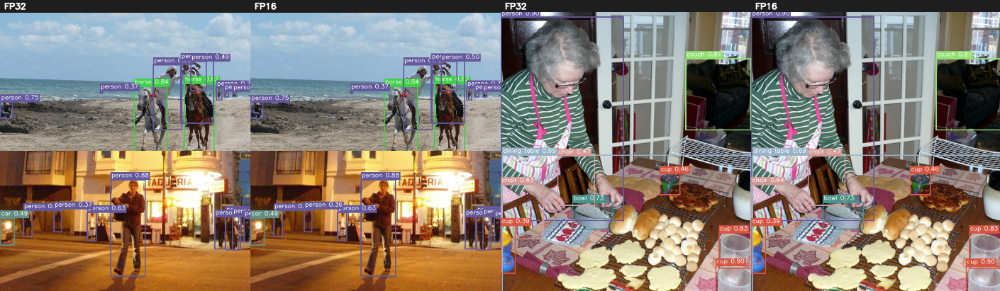
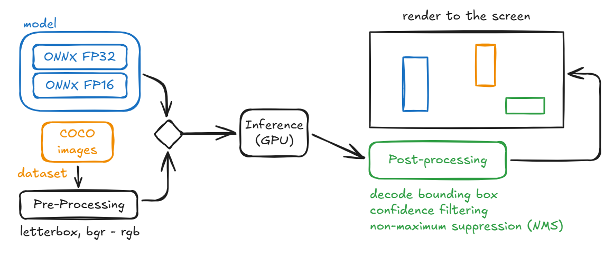

# trt_yolo_bench

**Make an object detector run ~2x faster on an NVIDIA GPU with half-precision math, and measure exactly what it costs in accuracy.**

YOLO11n taken from PyTorch to TensorRT 11 engines (FP32 and FP16), run through a hand-written C++ inference harness, and scored on COCO with the official evaluator.


**Keywords:** TensorRT · ONNX · CUDA · C++17 · YOLO11 · FP16 mixed precision · model optimization · inference latency · NMS · COCO / pycocotools · NVIDIA ModelOpt · edge AI deployment

**Why this project:** `model.export(format="engine")` gives you a fast model but hides what happened. Here every stage is built by hand (ONNX export, FP16 conversion, engine build, C++ preprocessing, head decode and NMS, COCO scoring) so the speed and accuracy trade-off of lower precision is measured, not assumed. It also targets TensorRT 11, which removed the `FP16` builder flag and the INT8 calibrator, so precision now has to come from the ONNX graph itself.

## Demo

<!-- TODO: add an annotated detection image or GIF produced by the harness, e.g. docs/images/demo.png -->


*Placeholder: detections from the C++ harness on a COCO val image.*

## Results

COCO val2017 (first 1000 images), Tesla T4 on Google Colab, TensorRT 11.4, CUDA 13.0, batch 1, 640x640, confidence 0.001, NMS IoU 0.7, 50 warmup + 1000 timed iterations.

| Precision | AP@[.5:.95] | AP@.5 | GPU mean | GPU p50 | GPU p99 | End-to-end mean | FPS | Engine size |
|---|---:|---:|---:|---:|---:|---:|---:|---:|
| TensorRT FP32 | 0.4110 | 0.5634 | 3.207 ms | 3.194 ms | 3.734 ms | 5.088 ms | 311.8 | 159.4 MB |
| TensorRT FP16 | 0.4108 | 0.5631 | 1.676 ms | 1.608 ms | 3.338 ms | 3.696 ms | 596.8 | 68.2 MB |
| **FP16 vs FP32** | **-0.0002** | **-0.0003** | **1.91x faster** | **1.99x faster** | 1.12x faster | 1.38x faster | 1.91x | 2.3x smaller |

FPS = `1000 / GPU mean ms` (inference only). End-to-end includes preprocessing, copies, decode and NMS. Single run per precision, so no error bars.

**Takeaway:** FP16 nearly doubles GPU throughput and cuts the engine to under half its size, with no measurable accuracy loss on this slice. The gain is in the mean and median; the p99 tail improves much less, and that is still unexplained. Full logs and caveats: [`RESULTS.md`](RESULTS.md).

## Workflow

<!-- TODO: replace with your architecture diagram, e.g. docs/images/architecture.png -->


`YOLO11n (.pt)` -> `ONNX` -> `FP16 ONNX (ModelOpt AutoCast)` -> `TensorRT FP32 / FP16 engines` -> `C++ harness (letterbox, inference, decode, NMS)` -> `COCO results JSON + latency CSV` -> `pycocotools (AP / AR)`

## What's inside

- **Export pipeline** (`export/`): deterministic COCO slice, PyTorch -> ONNX, FP16 conversion with NVIDIA ModelOpt (FP32 inputs/outputs kept), TensorRT engine builder
- **Inference harness** (`harness/`): C++17 on the raw `nvinfer1` API (`enqueueV3`), CUDA buffer management, letterbox preprocessing, hand-decoded `[1, 84, 8400]` YOLO head, custom NMS with no TensorRT plugin
- **Benchmarking**: CUDA-event GPU latency plus end-to-end latency, p50/p99 and raw per-iteration CSV
- **Evaluation** (`eval/`): detections in COCO results format, scored with the official `pycocotools`
- **Reproducibility** (`colab/`): one notebook and a runbook that rebuild every number on a Colab T4
- **Not included:** INT8 (TensorRT 11 needs an explicitly quantized Q/DQ ONNX graph; none was produced or benchmarked) and a PyTorch reference run

## Reproduce

Open [`colab/trt_yolo_bench_colab.ipynb`](colab/trt_yolo_bench_colab.ipynb) on a Colab **T4** runtime and run top to bottom, or follow [`colab/RUNBOOK.md`](colab/RUNBOOK.md):

```bash
python export/download_coco_slice.py --val-count 1000 --calib-count 500
python export/export_onnx.py --weights yolo11n.pt --out-dir models
python export/convert_fp16.py --input models/yolo11n.onnx --output models/yolo11n_fp16.onnx
python export/build_engines.py --onnx models/yolo11n.onnx --fp16-onnx models/yolo11n_fp16.onnx --engines-dir engines

cmake -S harness -B harness/build -DTENSORRT_INCLUDE_DIR=<dir with NvInfer.h> -DTENSORRT_LIB=<path to libnvinfer.so>
cmake --build harness/build --parallel
./harness/build/trt_yolo_bench engines/yolo11n_fp16.engine data/val_slice.json --out results_fp16.json --latency-out latency_fp16.csv

python eval/score_coco.py --dets results_fp16.json
```

Writes detections JSON and a per-iteration latency CSV, then prints COCO AP/AR.

## Roadmap

INT8 via Q/DQ quantization · repeated runs with confidence intervals · per-stage latency breakdown · full val2017 evaluation · investigate FP16 tail latency and FP32 engine size

MIT License · See [LICENSE](LICENSE)